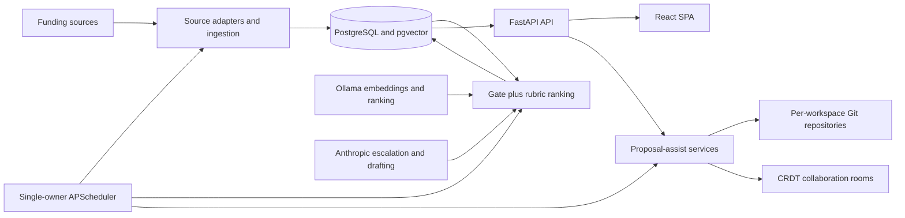

# Call-Monitor Architecture Review — Adversarial Second Pass

> **Superseded:** This document's severity ranking and its central "no verified P0"
> conclusion were expanded and partly overturned by
> [2026-08-29-third-pass-expansion.md](2026-08-29-third-pass-expansion.md), which
> found a measured whole-instance denial of service (105.87 s of blocking CPU from
> one legal 1 MB WebSocket frame, reachable by any workspace member). Use the third
> pass as the review of record. This document remains as the review artifact its
> findings were verified against.

**Date:** 2026-08-29  
**Scope:** Current working tree plus an adversarial review of the earlier
`2026-08-29-prioritized-architecture-review.md`  
**Status:** Superseded by the third pass; supersedes the earlier document's priorities  
**Code changes:** None; this is a review artifact

---

## 1. Method and evidence standard

This pass treated every high-priority statement in the earlier review as a
hypothesis to refute. It used direct code reads, independent subsystem checks,
AST/counting probes, targeted tests, and the existing full-suite result. Claims
are classified as follows:

- **Confirmed:** current code or an executed check directly demonstrates it.
- **Partial:** a narrower current defect exists, but the earlier wording or
  severity was too broad.
- **Stale/refuted:** current code contradicts the earlier claim.
- **Carried:** retained in the defect register but not independently reverified
  in this pass; it must not be treated as a current fact until checked.

Measured evidence:

| Check | Result |
|---|---|
| Backend suite | `3964 passed, 1 skipped, 326 warnings in 214.05s` |
| Focused serial warning reproduction | `3 passed, 3 warnings`; one additional open-connection `ResourceWarning` appeared after the summary |
| Frontend suite | `118` files and `817` tests passed |
| Fence inventory | `16` tracked slices: `11 complete`, `5 pending` |
| Ports construction | `5` production `build_ports(...)` call sites |
| Tool registry AST | `29` ToolContext fields; `_collect_tools` is `674` lines and registers `24` tools |
| Pass-runner similarity | coherence/evaluator `0.616`; evaluator/uncited-claims `0.638`; review is structurally distinct (`0.155`–`0.188`) |

The earlier review's full backend result remains valid evidence of broad
behavioral health. Passing tests do not, by themselves, prove the absence of
race defects or validate warning hygiene.

---

## 2. Executive verdict

**Architecture grade: B+**

The architecture is healthy and production-minded. The strongest boundaries
are the deterministic ranking core, database-backed lifecycle fencing, source
adapter boundary, generated OpenAPI frontend contract, scheduler ownership
lock, and explicit startup/shutdown lifecycle. A rewrite is not warranted.

There is **no verified P0 defect** in this review. The earlier document's four
P0 items mixed current production defects, planned migration work, maintenance
debt, and a test-harness leak under one severity. That priority order is
withdrawn.

The current highest-value work is narrower:

1. close two real background-job race/accounting gaps;
2. make disclosure errors a machine-readable API contract;
3. stop API tests from leaking per-app engines and restore warning signal;
4. consolidate duplicated collab mutation orchestration;
5. complete the five pending fence slices according to the existing plan.

---

## 3. Architecture overview

### Boundary assessment

| Boundary | Assessment | Main residual risk |
|---|---|---|
| Ingestion adapters | Strong | transport internals and duplicated fetch ceremony |
| Ranking core | Strong | shared client Protocol and worker decomposition |
| FastAPI/API | Strong base | generic status-derived error codes |
| Proposal-assist | Correctness-focused, complex | context growth and migration overlap |
| Collaboration | Strong kernel | duplicated orchestration at kernel edges |
| Jobs/lifecycle | Strong locking substrate | family drift in race handling/accounting |
| Data layer | Constraint-rich | large model module and hot workspace row |
| React SPA | Typed API boundary | stringly error handling and no lint gate |
| Deployment lifecycle | Strong | test construction does not follow production lifecycle |

---

## 4. Prioritized confirmed findings

### P1-1 — Coherence can launch after cancellation or deletion

**Severity:** Medium-high  
**Confidence:** High  
**Status:** Confirmed production race

Evaluator and Uncited Claims re-read the job immediately before launching the
hosted adapter ([evaluator/pass_runner.py](../../../src/call_manager/proposal_assist/evaluator/pass_runner.py#L120),
[uncited_claims/pass_runner.py](../../../src/call_manager/proposal_assist/uncited_claims/pass_runner.py#L141)).
Coherence proceeds from context assembly to `adapter.launch()` without the same
live-status check ([coherence/pass_runner.py](../../../src/call_manager/proposal_assist/coherence/pass_runner.py#L67)).

**Harm:** If workspace deletion, cancellation, or the reaper marks the job
failed after the prefix transaction but before launch, Coherence may still send
deleted-workspace content to the hosted model and incur spend. Finalization
will not resurrect the row, but that guard acts too late to prevent disclosure
or cost.

**Coverage gap:** Evaluator and Uncited Claims have tests proving cancellation
prevents launch. No equivalent Coherence test was found.

**Action:** Add the same pre-launch status check and a race regression test to
Coherence before extracting any common runner abstraction.

### P1-2 — Coherence and Evaluator lose late token spend

**Severity:** Medium-high  
**Confidence:** High  
**Status:** Confirmed accounting defect

Both runners return when finalization sees a non-running row before writing the
arrived `TurnDoneEvent` token totals:

- [coherence/pass_runner.py](../../../src/call_manager/proposal_assist/coherence/pass_runner.py#L154)
  returns before token assignment at line 170.
- [evaluator/pass_runner.py](../../../src/call_manager/proposal_assist/evaluator/pass_runner.py#L174)
  returns before token assignment at line 183.

Uncited Claims deliberately records token/session accounting before respecting
the terminal status ([uncited_claims/pass_runner.py](../../../src/call_manager/proposal_assist/uncited_claims/pass_runner.py#L190));
Review does the equivalent at item/run level. The earlier review was therefore
correct about **two of four** families, while one verifier's broader “three
families” claim was false.

**Harm:** A model call that finishes after deletion, cancellation, or reaping is
real spend but contributes zero to the workspace daily cap. Repeated
cancel/retry races can allow actual usage to exceed the configured budget.

**Coverage gap:** Late-spend tests exist for Uncited Claims and Review, not for
Coherence or Evaluator.

**Action:** Backport the “record spend, do not resurrect status” finalization
rule and its tests to both runners.

### P1-3 — Disclosure handling depends on human message text

**Severity:** Medium  
**Confidence:** High  
**Status:** Confirmed API/UI contract defect

The API client already preserves a structured `ApiError.code`
([frontend/src/api/client.ts](../../../frontend/src/api/client.ts#L8)), but both
selection toolbars detect disclosure by applying `/disclosure/i` to the message:

- [SelectionToolbar.tsx](../../../frontend/src/cockpit/SelectionToolbar.tsx#L64)
- [TiptapSelectionToolbar.tsx](../../../frontend/src/collab/TiptapSelectionToolbar.tsx#L85)

The backend raises a plain 403
([_cloud_gate.py](../../../src/call_manager/proposal_assist/web/_cloud_gate.py#L39)),
which the generic API handler maps to `forbidden`, so the client has no semantic
code to consume.

**Harm:** Rewording or translating the message can remove the acknowledgement
and retry UI and leave a member with a generic failure. This is especially
relevant to selection Ask, where the toolbar comment states that members do not
have the owner chat-footer acknowledgement path.

**Test observation:** All `817` frontend tests pass, but the tests preserve the
fragile contract: one supplies message text containing “disclosure”; another
uses `disclosure_required` while production still emits `forbidden`.

**Action:** Emit `disclosure_required` through a typed API exception/handler,
branch on `e.code`, and add one backend contract test plus both toolbar tests.

### P1-4 — API tests leak per-app database engines

**Severity:** Medium for test infrastructure; unproven for production  
**Confidence:** High for the leak, high that the prior P0 production claim was overstated  
**Status:** Confirmed test-lifecycle defect

The focused serial run reproduced open psycopg connections without xdist. A
representative path constructs an app in `_app()` and uses a non-context-managed
`TestClient` ([test_api_me.py](../../../tests/test_api_me.py#L6)). That form does
not run the app lifespan teardown that disposes `app.state.engine`. The shared
database fixture disposes its own engine
([tests/conftest.py](../../../tests/conftest.py#L40)), but not every engine
created by `create_app()`.

Production has explicit ordered teardown: scheduler shutdown, advisory-lock
release, drafting-controller termination, then engine disposal
([main.py](../../../src/call_manager/main.py#L305),
[main.py](../../../src/call_manager/main.py#L336)). No production leak was
demonstrated.

The narrow `error::ResourceWarning` filter does not catch every full-suite
instance because destructor failures may be surfaced as
`PytestUnraisableExceptionWarning` or after normal capture. The resulting 326
warnings reduce signal and can conceal a new production-path lifecycle defect.

**Action:** Centralize API app/client construction in a fixture that always
closes the `TestClient` and disposes unused app engines. Then run the full suite
with both `ResourceWarning` and `PytestUnraisableExceptionWarning` fatal.

---

## 5. Prioritized architecture debt

### P2-1 — Collab mutation orchestration remains duplicated four times

**Status:** Confirmed  
**Severity:** Medium maintenance risk

Four entry points repeat the same room acquisition, lock, threadpool mutation,
commit, broadcast, and eviction sequence while maintaining separate clean-error
tuples:

- `accept_via_kernel` and `_CLEAN_ACCEPT_ERRORS` in
  [kernel_accept.py](../../../src/call_manager/proposal_assist/proposals/kernel_accept.py#L45)
- `direct_cite_via_kernel`, `init_spec_via_kernel`, and
  `insert_annotation_via_kernel` in
  [collab_cite.py](../../../src/call_manager/proposal_assist/citations/collab_cite.py#L33)

The duplication is real, but the second pass did not independently establish a
current production failure caused by it. It is P2 architecture debt, not P0.

**Action:** Extract one orchestrator only after characterization tests lock down
which exceptions imply “room may be ahead; evict” for each mutation body.

### P2-2 — Fence conversion is active, not unused

**Status:** Earlier claim partially refuted  
**Severity:** Medium roadmap risk

The inventory currently contains **16** tracked slice keys: **11 complete** and
**5 pending** ([tests/fencing/inventory.py](../../../tests/fencing/inventory.py#L75)).
The pending keys are `F3e1b`, `F3e2`, `F3f`, `F4`, and `F5`.

The prior “zero production consumers” claim is stale. `build_ports(...)` is
used in five production construction paths: interactive drafting, Coherence,
Evaluator, Review, and Uncited Claims. New proposal/citation writes call
`ports.effects`; old functions remain in `proposals/proposing.py`, but no
production callers were found.

**Action:** Continue the pending conversion plan. Remove or formally deprecate
the legacy proposing functions after their remaining test use is migrated.

### P2-3 — Tool registration composition is oversized

**Status:** Confirmed, reprioritized  
**Severity:** Medium maintenance risk

AST measurement finds:

- `ToolContext`: **29 fields**, not 28
  ([registry.py](../../../src/call_manager/proposal_assist/tools/registry.py#L46))
- `_collect_tools`: **674 lines**, not 657, registering **24 tools**, not 21
  ([registry.py](../../../src/call_manager/proposal_assist/tools/registry.py#L314))

The context is cohesive enough to be understood as execution context, so
calling it a high-severity behavioral god object is overstated. It nonetheless
combines stable workspace dependencies, mutable per-turn identity, read
snapshots, specialization inputs, UI gating, and capability ports. The closure
repeats registration/schema/wrapper ceremony and requires a tool to be wired in
more than one place.

**Action:** Finish `F3f` before redesigning the holder. Then extract
phase-specific immutable subcontexts and adopt a declarative registration
table with a test that every declared tool is returned.

### P2-4 — Frontend has no lint gate and emits test-console noise

**Status:** Confirmed  
**Severity:** Medium process risk

[frontend/package.json](../../../frontend/package.json#L9) exposes `build`,
`test`, and API generation but no lint script or linter dependency. The fresh
frontend run passed all tests while emitting React `act(...)` warnings and
jsdom navigation errors. These do not fail the suite and make real warnings
easier to miss.

**Action:** Add an intentional lint gate and fail tests on unexpected console
errors after allowlisting unavoidable jsdom limitations narrowly.

---

## 6. Corrections to the earlier review

| Earlier claim | Second-pass disposition |
|---|---|
| Resource warnings are the top P0 production-stability defect | **Overstated.** A serial test-harness engine leak is confirmed; production teardown is explicit and no production leak was shown. |
| Ports layer has zero production consumers | **Refuted/stale.** Five production construction paths call `build_ports`. |
| F3 conversion is effectively unoperationalized | **Refuted in part.** Eleven of 16 tracked slices are complete; five remain pending. |
| Duplicate write systems are both active | **Refuted in part.** Legacy functions remain, but current production proposal/citation tools use ports effects. |
| ToolContext is a 28-field high-severity god object | **Count corrected and severity reduced.** It has 29 fields and is P2 maintainability debt. |
| `_collect_tools` is 657 lines with 21 tools | **Counts corrected.** It is 674 lines with 24 registered tools. |
| All four job families have equivalent drift | **Narrowed.** Coherence lacks the pre-launch check; Coherence and Evaluator lose late token spend; Uncited Claims and Review contain the relevant fixes. |
| Four copied collab orchestrators are P0 | **Confirmed mechanism, reduced to P2.** No current outage or corruption path was demonstrated in this pass. |
| Hybrid Jinja/SPA migration is a central current risk | **Stale emphasis.** Current route guards show retired Jinja surfaces; migration residue should be checked per route rather than treated as a blanket risk. |

---

## 7. Preserved defect register

The earlier review artifact is retained, including every defect candidate. The
following items remain useful backlog leads but were not individually reverified
in this pass. Their status is **carried**, not confirmed:

### Ingestion and sources

- mixed transport/retry/SSRF ownership in `sources/types.py`
- private httpx/httpcore IP-pinning internals
- duplicated stream-fetch skeleton
- SourceAdapter/orchestrator contract mismatch
- multi-site source registration
- blocking I/O during EU normalization
- inconsistent transport policy
- repeated circular-import workarounds
- defensive CLI duck typing

### Ranking and embeddings

- no shared chat-client Protocol
- shared LLM error owned by one adapter
- duplicated dead-letter SQL
- oversized `drain_queue`
- ranking imports proposal-assist private helpers
- adapter signature mismatch
- repeated `RankResult` construction
- validator imports private ranking helpers
- duplicated import-time report configuration

### Web and API

- mixed router mounting/response typing conventions
- duplicated workspace metadata limits
- inconsistent existence-disclosure policy
- private cross-module imports
- widespread `app.state` service-location and two session idioms
- lifespan/controller private access
- middleware documentation drift
- near-clone manual trigger routes

The previous “workspaces router god module” and blanket
“exception-to-HTTP shotgun surgery” claims remain refuted by the earlier
adversarial check and are not defect candidates.

### Proposal-assist and collaboration

- large `_collect_tools` registration surface
- human accept path dependence on tool internals
- incomplete DraftingAgent Protocol
- duplicated citation verification
- oversized `submit_user_turn`
- controller access to registry internals
- inconsistent per-turn tool deny checks
- write-kernel private imports
- duplicated section-edit rules
- kernel-routing invariant enforced by convention
- checkpoint mode flags and cross-subsystem side effects
- citation mutation mode flags
- repeated ProposedChange resolution

### Jobs, lifecycle, and data

- large scheduler composition root and dual configuration path
- hard-coded per-family deletion fan-out
- oversized digest assembly/send state machines
- comment-enforced lock order
- inconsistent reaper contracts
- monolithic model module
- repeated job-table columns and status vocabularies
- growing workspace hot row
- dual session acquisition patterns
- duplicated profile validation limits
- comment-enforced session-per-unit-of-work rule
- HTTP exceptions leaking into domain helpers
- under-typed profile services

### Frontend

- shell knowledge of cockpit details
- stringly TanStack query keys
- feature-local global editor store
- API-to-feature type dependency
- broad sidebar and library panel responsibilities
- duplicated local Turn types
- duplicated score-band thresholds
- mode boolean on `ArtifactSectionEditor`

These carried items should be promoted to the prioritized list only after a
current caller read and a concrete harm scenario. Size, duplication, or style
alone is insufficient for P1 severity.

---

## 8. Recommended sequence

1. **Fix and test the two job-family behavioral gaps.** This prevents avoidable
   hosted disclosure/spend and makes budget accounting honest.
2. **Introduce `disclosure_required` as an end-to-end error code.** Remove both
   message regexes and contract-test the backend envelope.
3. **Repair API test lifecycle ownership.** Use managed clients/apps and make
   unraisable resource warnings fatal; rerun the full backend suite.
4. **Characterize and extract collab mutation orchestration.** Preserve the
   exact eviction semantics with tests first.
5. **Complete the five pending fence slices.** Follow the existing inventory
   and plans; do not reopen already-converted paths.
6. **Reduce tool composition only after F3f.** Splitting ToolContext before the
   capability-holder slice would create churn against the migration direction.
7. **Verify carried findings opportunistically.** Promote only findings with a
   current behavior or operational failure story.

---

## 9. Final assessment

The system's risk is not a weak foundational architecture. It is localized
behavioral drift at repeated edges, plus test infrastructure that does not
consistently exercise the production lifecycle. The second pass finds no basis
for a rewrite and no verified P0 incident. It does find three concrete P1
themes worth addressing before broad cleanup: background-job race/accounting
parity, semantic API errors, and deterministic test resource ownership.

The right strategy remains incremental: repair the demonstrated behaviors,
finish the existing fence migration, and use the project's strong tests and
structural gates to prevent recurrence.