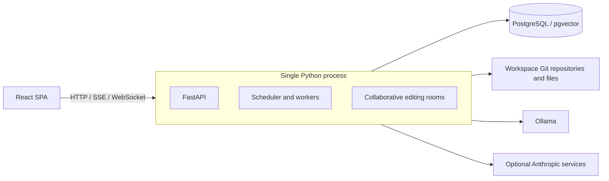

# Grant Lab architecture review — 2026-09-05

Reviewed the working tree through commit `4e6212e2`. No project files were changed
during the review; this document was saved afterward at the user's request.

## Assessment

The project has a sound modular-monolith foundation, but **runtime ownership and
state consistency need more attention than module organization**. Retain the
overall stack and address the boundaries below first.

The architecture is straightforward at deployment level:

## Findings

The findings are ordered by priority. Source line references describe the reviewed
tree and may move in subsequent revisions.

### 1. High — Single-instance ownership is monitored but not enforced after startup

When the advisory-lock connection dies, `SchedulerLock.is_held()` logs the loss and
returns false. The scheduler and application continue running, and `/healthz` still
returns HTTP 200 if ordinary database access succeeds. Another instance can then
acquire the lock while the original process remains active.

Evidence:

- [Lock-loss handling](../../../src/grant_lab/scheduler.py), line 70.
- [Health reporting](../../../src/grant_lab/web/routes/health.py), line 38.

This undermines the deployment invariant that protects scheduling and process-local
collaboration state. Add active ownership monitoring that makes the instance unready
and stops it when ownership is lost. Stopping only scheduled jobs would leave the
other process-local writers active.

### 2. High — Matching freshness is not represented durably

Profile updates commit before scheduling embedding refresh and ranking backfill
through an in-process background task. A crash between those steps loses the refresh
request.

There is also a normal failure case: refresh uses `force=False`, so an embedding
outage preserves the previous vector and model identifier. This behavior was
reproduced with in-memory fakes. The daily repair selects missing vectors or model
mismatches, and ranking reconciliation selects missing rankings; neither detects
that existing results describe older profile content.

Evidence:

- [Profile update](../../../src/grant_lab/web/api/profiles.py), line 454.
- [Background refresh and backfill](../../../src/grant_lab/profiles/post_edit.py), lines 11 and 30.
- [Refresh failure handling](../../../src/grant_lab/embeddings/refresh.py), line 123.
- [Ranking reconciliation](../../../src/grant_lab/ranking/queue.py), line 146.

Record a durable refresh obligation in the profile-update transaction, and associate
embeddings and rankings with input revisions or content hashes. This gives recovery
a way to distinguish “exists” from “current.”

### 3. Medium — Match-edition isolation stops at application construction

The isolation test calls `create_app()` without entering the lifespan. Actual
startup still builds the workspace controller, collaboration services, and proposal
background machinery.

Evidence:

- [Isolation test probe](../../../tests/architecture/test_match_edition_process_cut.py), line 41.
- [Startup composition](../../../src/grant_lab/main.py), line 212.

A startup probe, with database access and scheduler execution stubbed, measured:

- After `create_app()`: **0 proposal-assist modules**.
- During lifespan: **45 proposal-assist modules**, including `pycrdt` and `claude_agent_sdk`.
- **25 registered jobs** under the probe's configuration, including proposal jobs.

Make lifecycle construction and job registration edition-specific, and test isolation
through startup. The frontend bundle and API route separation are useful foundations.

### 4. Medium — Background passes still perform blocking work on the application event loop

The scheduler explicitly dispatches evaluator work onto FastAPI's loop. That
coroutine directly performs synchronous SQLAlchemy operations and document-context
assembly. Coherence has the same pattern.

Evidence:

- [Evaluator dispatch](../../../src/grant_lab/scheduler.py), line 930.
- [Evaluator pass execution](../../../src/grant_lab/proposal_assist/evaluator/pass_runner.py), line 81.
- [Evaluator context assembly](../../../src/grant_lab/proposal_assist/evaluator/context.py), line 84.
- [Coherence pass execution](../../../src/grant_lab/proposal_assist/coherence/pass_runner.py), line 75.

Slow database access, lock waits, or document processing can therefore delay
unrelated WebSocket, SSE, and async request handling. Offload complete synchronous
transaction/context-building units to workers, keeping each session within its
worker. Increasing scheduler thread counts does not address this particular
bottleneck.

### 5. Medium — Git and PostgreSQL writes require a stronger recovery contract

The code correctly declares the durable Yjs log authoritative for collaborative
artifacts. However, checkpoints write Git before the caller commits database
changes. An accepted edit can therefore reach Git while its Yjs update and
acceptance metadata subsequently roll back.

Evidence:

- [Canonical document contract](../../../src/grant_lab/proposal_assist/collab/canonical.py), line 3.
- [Git checkpoint write](../../../src/grant_lab/proposal_assist/collab/checkpoint.py), line 244.
- [Accept transaction commit](../../../src/grant_lab/proposal_assist/proposals/kernel_accept.py), line 108.
- [Existing reconciliation](../../../src/grant_lab/proposal_assist/reconcile.py), line 1.

Existing reconciliation and room eviction mitigate parts of this. They do not make
the stores transactional together. Treat this as a known architectural failure
window, rather than newly reproduced corruption. Define durable operation identity
and recovery behavior across both stores; a longer-term direction is projecting
committed document state into Git through retryable operations. Backup and restore
should exercise the same consistency contract.

## Strengths and maintainability

Several architectural choices are strong: PostgreSQL constraints enforce meaningful
invariants; source ingestion, ranking, and proposal assistance have recognizable
domain boundaries; the frontend uses generated API types and centralized error
handling; and collaboration has explicit persistence, checkpoint, compaction, and
document-epoch mechanisms.

The current model split also looks structurally sound: **all 48 class definitions
match their pre-split ASTs**, all **45 tables** resolve in SQLAlchemy metadata, and
the generated architecture map matches the source.

For maintainability, the next useful work is narrower service contracts around the
four proposal pass families and the 29-field `ToolContext`. Existing `Ports`
interfaces provide a starting point. Prioritize the reliability findings above
before expanding that abstraction work.

## Validation and limits

Validation comprised source inspection, in-memory startup/failure probes, AST
comparison, and metadata checks. The full test suite was not run, and live services
were not exercised.

The startup probe disabled `.env` loading, used a dummy database URL, stubbed
database access and admin bootstrap, and constructed the real scheduler with
`start=False`. Its measurements demonstrate startup composition; they are not a
live deployment or throughput test. The embedding-failure probe used only fake
objects and a simulated `LLMError`.

Older review findings were checked against the current tree: this checkout now has
a Git remote, and the test fixtures redirect golden-set output to temporary
storage. Neither was carried forward as an open finding. Remote CI execution was
not verified.

---

# Verification and disposition — added 2026-09-05, by the session that received this review

Everything above is the reviewer's text, unedited except for one mechanical change: its
source links were written for a repo-root directory, so each `../../` became `../../../`
when the file moved into `docs/superpowers/reviews/`. Its filename also changed, because
`2026-09-05-architecture-review.md` was already taken by a different review of the same
day (the `ed1153a3` grade-B+ one). This file is named for what the review is *about*,
which is how `INVESTIGATIONS.md` indexes.

**Nothing below is the reviewer's claim. It is what was actually run against `05bd151c`.**
A review that could not execute anything is a set of leads, not facts — and two of the
leads below turned out to be partly wrong in a way only running them showed.

| # | Finding | Status |
| --- | --- | --- |
| 1 | Lock loss is monitored, not enforced | **CONFIRMED — OPEN** |
| 2 | Matching freshness is not durable | **CONFIRMED — OPEN**, fix scheduled |
| 3 | Match isolation stops at construction | **CONFIRMED — FIXED** (`1fdfe050`) |
| 4 | Blocking work on the app event loop | **CONFIRMED, narrower** — full edition only |
| 5 | Git/Postgres recovery contract | **NOT VERIFIED — DEFERRED** |

## 1 — CONFIRMED, open

`/healthz` pings the database, and on success returns **HTTP 200** with
`scheduler_lock: false` in the body when the advisory lock has been lost
(`web/routes/health.py`). Its own docstring says *"Monitoring should treat any non-200 as
'do not route traffic / page operator'"* — and lock loss never produces a non-200. An
orchestrator watching status codes keeps routing to a process that no longer owns the
single-instance invariant, while its collab rooms, drafting registry, pass registry and
lifecycle tombstones stay live.

Not fixed here. It is a deployment-behaviour change (when should a process make itself
unready, and should it exit?) and deserves its own decision.

## 2 — CONFIRMED, open; the fix is scheduled and small

The reviewer's second half is the part that matters, and it is exact. The daily repair's
own docstring states its selection:

> *"scan for NULL-embedding rows AND rows whose `embedding_model` differs from the
> currently-configured model"*

So the sequence is: a profile's description is edited; the background refresh
(`profiles/post_edit.py`) runs outside the request and swallows every error by design,
trusting that daily tick; Ollama is down, so `refresh_profile_embedding` raises `LLMError`
and — because `force=False` — **keeps the old vector and the old, still-current
`embedding_model`** (`embeddings/refresh.py`). That row is now neither NULL nor
model-mismatched. The repair will never select it. Rankings continue to score calls
against superseded profile text, silently and indefinitely.

The system can distinguish **missing** from **present**. It cannot distinguish **present**
from **current**, which is the reviewer's phrasing and is correct.

This is in the MATCH half — profiles, embeddings, ranking — the half release 1 ships.

**Decided fix, and its sequencing.** `build_profile_text(profile)` already exists and is
the single definition of what gets embedded. Store a hash of it on the row and have the
repair select `hash != current_hash` alongside its two existing arms: one column, one
predicate. That is the "exists vs current" distinction the review asks for, at close to
the minimum cost.

Deliberately **not** done in the same window as Plan C. Both need a migration, and two
branches numbering off one head is the exact collision the profile-visibility merge
already produced once. This lands after Plan C merges.

## 3 — CONFIRMED, and fixed

Measured under `APP_EDITION=match DRAFTING_ENABLED=false`: **0** proposal-assist modules
after `create_app()`, **45** once the lifespan ran, with `pycrdt` and `claude_agent_sdk`
both loaded. The reviewer's count of 45 was exact.

Cause: seven unconditional proposal-assist imports inside `lifespan()`. Deferring them out
of `create_app()` is what made the existing gate green; it never made a running match
process clean. Fixed in `1fdfe050`, together with a second bug found while fixing it —
`drafting_idle_sweep` was the only one of the eight proposal ticks with no
`drafting_enabled` guard, so a match deployment registered it and fired it on every
interval.

**The gate now boots both editions through a real lifespan against a real Postgres**, and
was proved by mutation rather than by a green run: with the edition guard reverted, the
four `create_app()` cases still passed and the new lifespan case failed. That contrast is
the finding.

One caution for whoever reads this next. An early attempt to check the reviewer's
`claude_agent_sdk` claim *imported* the seven modules without *calling*
`build_workspace_controller`, measured 41 modules and no SDK, and concluded the reviewer
was wrong. It was not — the constructor is what pulls the SDK. Importing a module graph
is not the same measurement as running the code that uses it.

## 4 — CONFIRMED as a mechanism, but narrower than written

`asyncio.run_coroutine_threadsafe(coro, app_loop)` does put evaluator and coherence work
on the request loop, and those coroutines do synchronous SQLAlchemy work. But every one of
those ticks returns early on `if not settings.drafting_enabled`, and `APP_EDITION=match`
**requires** `DRAFTING_ENABLED=false` (`config.py::_match_edition_disables_drafting`). So
this cannot occur in a match deployment. It is a full-edition concern only, which the
review does not say.

## 5 — NOT VERIFIED, deliberately deferred

Checkpoints writing git before the caller commits is a real shape and the review is
careful about it, explicitly calling it *"a known architectural failure window, rather
than newly reproduced corruption."* It is entirely within proposal-assist — collab
checkpoints, `kernel_accept`, the Yjs log — which release 1 does not sell.

Deferred on that basis, not because it was checked and dismissed. **Nobody has reproduced
it, in either direction.** The related prior finding is
`2026-08-25-grok-fence-elimination-architecture-review.md`'s "git is a side effect outside
the Postgres transaction", which this index already warns has been re-derived once.

## What the review got right that is worth keeping

Its closing structural claim was independently checked and matches: after `models.py` was
split into a package, all **48** class definitions are byte-identical to their pre-split
sources, all **45** tables resolve in `Base.metadata`, and `scripts/gen_architecture.py`
regenerates `docs/ARCHITECTURE.md` unchanged.
